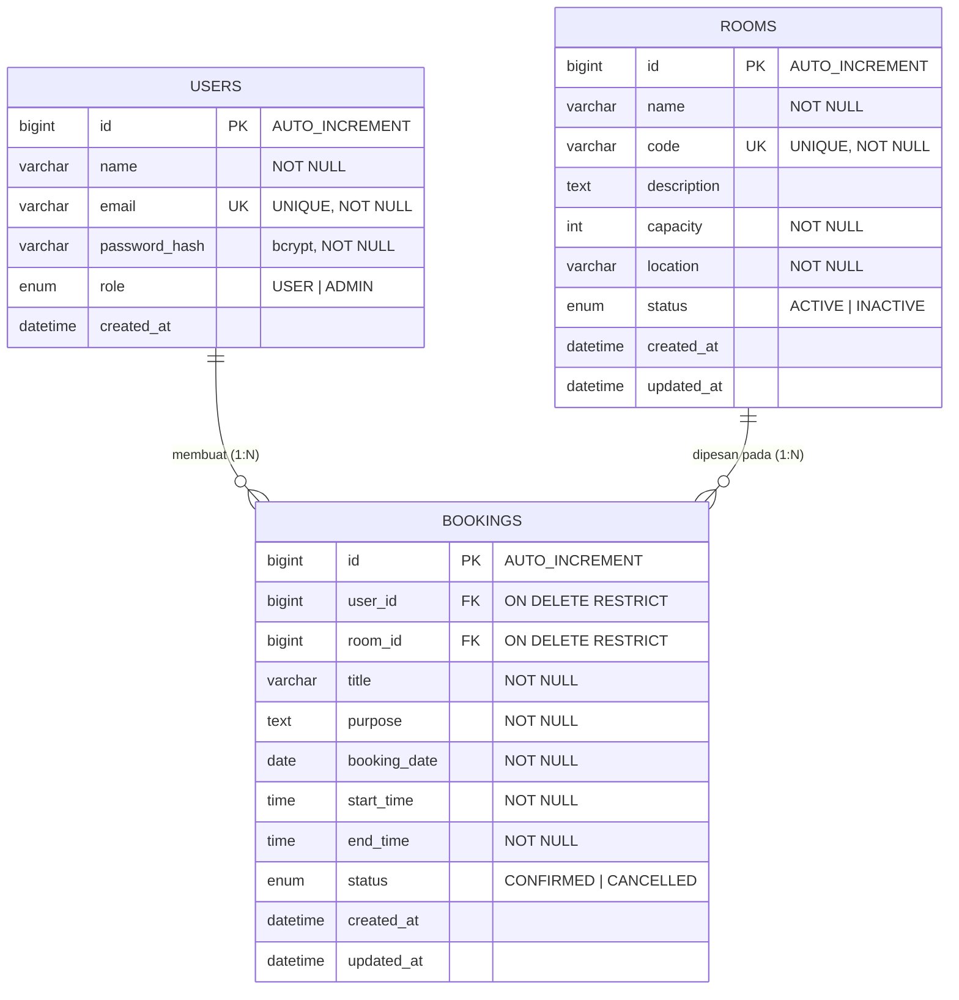

# University Room Booking System

Aplikasi berbasis web untuk pemesanan dan pengelolaan ruangan di lingkungan universitas dengan mekanisme **auto-confirm** dan pencegahan **double booking** menggunakan transaksi database (`FOR UPDATE`).

Proyek ini dibangun menggunakan **Golang (Gin)** + **MySQL** (Raw SQL `database/sql`) pada sisi backend, serta **React (Vite)** pada sisi frontend.

---

## Fitur Utama

- **Autentikasi & Otorisasi Role:** Login berbasis JWT (`USER` dan `ADMIN`) dengan hashing password `bcrypt`.
- **Manajemen Master Ruangan (`ADMIN`):** Tambah ruangan baru, ubah informasi ruangan, serta aktif/nonaktifkan status ruangan (`ACTIVE` / `INACTIVE`).
- **Auto-Confirm Booking (`USER`):** Pemesanan ruangan langsung berstatus `CONFIRMED` apabila ruangan berstatus aktif dan jadwal tersedia.
- **Anti-Bentrok & Concurrency Safety:** Validasi irisan jadwal dalam zona waktu `Asia/Jakarta` (WIB) yang dibungkus transaksi database `BeginTx` + row-level lock `SELECT ... FOR UPDATE`.
- **Cek Ketersediaan Jadwal Real-Time:** Pengguna dapat melihat daftar slot jam terpakai pada tanggal tertentu sebelum mengajukan pemesanan.
- **Pembatalan & Status Turunan:** Pembatalan booking oleh pemilik sebelum jam mulai tiba (`CANCELLED`), serta label status `COMPLETED` otomatis saat waktu pemakaian berakhir.

---

## Kebutuhan Sistem

- **Go** versi 1.21 atau lebih baru
- **Node.js** versi 18 atau lebih baru (untuk menjalankan frontend)
- **MySQL** 8.0+ / **MariaDB** 10.6+ (Laragon / XAMPP)
- **Postman** atau **Insomnia** untuk pengujian endpoint API

---

## Struktur Direktori

```text
university-room-booking/
├── backend/
│   ├── cmd/
│   │   └── server/main.go          # Entry point aplikasi REST API
│   ├── internal/
│   │   ├── config/database.go      # Koneksi database/sql MySQL & timezone WIB
│   │   ├── dto/dto.go              # Struct validasi request & response
│   │   ├── handler/                # HTTP handler (Gin)
│   │   ├── middleware/auth.go      # Middleware JWT & validasi role
│   │   ├── model/models.go         # Representasi entitas database
│   │   ├── repository/             # Eksekusi Raw SQL (database/sql)
│   │   ├── routes/routes.go        # Definisi routing /api/v1 & CORS
│   │   └── service/                # Logika bisnis & validasi aturan jadwal
│   ├── migrations/
│   │   ├── 001_init_schema.sql     # DDL tabel users, rooms, bookings + index & FK
│   │   └── 002_seed_data.sql       # Data awal akun demo, ruangan, dan sampel booking
│   ├── .env.example                # Template konfigurasi environment backend
│   ├── .gitignore
│   ├── go.mod
│   └── University_Room_Booking.postman_collection.json
├── frontend/
│   ├── src/
│   │   ├── api/client.js           # Fetch wrapper dengan header Bearer JWT
│   │   ├── components/
│   │   │   ├── BookingsPage.jsx    # Form booking, daftar booking, detail & pembatalan
│   │   │   ├── Dashboard.jsx       # Ringkasan statistik sesuai role
│   │   │   ├── Navbar.jsx          # Navigasi utama aplikasi
│   │   │   └── RoomsPage.jsx       # Daftar ruangan, cek jadwal & CRUD ruangan ADMIN
│   │   ├── App.css
│   │   ├── App.jsx                 # Halaman login & manajemen sesi autentikasi
│   │   └── main.jsx
│   ├── .env.example                # Template konfigurasi environment frontend
│   └── package.json
└── README.md
```

---

## Langkah Instalasi & Menjalankan Aplikasi

### 1. Clone Repositori
```bash
git clone <url-repository-anda>
cd university-room-booking
```

### 2. Siapkan Database MySQL
Impor file skema tabel dan data awal secara berurutan melalui terminal MySQL atau phpMyAdmin:
```bash
mysql -u root -p < backend/migrations/001_init_schema.sql
mysql -u root -p < backend/migrations/002_seed_data.sql
```

### 3. Jalankan Backend (Golang + Gin)
```bash
cd backend
cp .env.example .env
# Sesuaikan konfigurasi DB_USER, DB_PASSWORD, DB_NAME, dan JWT_SECRET pada file .env

go mod tidy
go run cmd/server/main.go
```
Server backend akan berjalan pada `http://localhost:8080`.

### 4. Jalankan Frontend (React + Vite)
Buka terminal baru, lalu masuk ke direktori `frontend`:
```bash
cd frontend
cp .env.example .env
npm install
npm run dev
```
Aplikasi frontend dapat diakses melalui URL yang ditampilkan Vite (umumnya `http://localhost:5173`).

---

## Kredensial Akun Demo Lokal

Seluruh akun bawaan dari `002_seed_data.sql` menggunakan password **`password`** (tersimpan di database dalam bentuk hash `bcrypt`):

| Role | Nama | Email | Password |
| :--- | :--- | :--- | :--- |
| `ADMIN` | Admin Kampus | `admin@univ.ac.id` | `password` |
| `USER` | Farhan | `farhan@student.univ.ac.id` | `password` |
| `USER` | Naufal | `naufal@student.univ.ac.id` | `password` |

---

## Diagram ERD



---

## Ringkasan Endpoint API (`/api/v1`)

Seluruh endpoint privat wajib menyertakan header `Authorization: Bearer <token>`.

| Method | Endpoint | Hak Akses | Keterangan |
| :--- | :--- | :--- | :--- |
| `POST` | `/auth/login` | Publik | Login dan mendapatkan token JWT |
| `GET` | `/auth/me` | `USER`, `ADMIN` | Mengambil profil pengguna dari token JWT |
| `GET` | `/dashboard` | `USER`, `ADMIN` | Mengambil ringkasan statistik sesuai role |
| `GET` | `/rooms` | `USER`, `ADMIN` | Daftar ruangan (`USER` hanya `ACTIVE`, `ADMIN` semua) |
| `GET` | `/rooms/:id` | `USER`, `ADMIN` | Detail informasi ruangan |
| `GET` | `/rooms/:id/availability` | `USER`, `ADMIN` | Mengecek slot terpakai pada tanggal (`?date=YYYY-MM-DD`) |
| `POST` | `/rooms` | `ADMIN` | Menambahkan data ruangan baru |
| `PATCH` | `/rooms/:id` | `ADMIN` | Mengubah data atau status `ACTIVE`/`INACTIVE` ruangan |
| `GET` | `/bookings` | `USER`, `ADMIN` | Daftar booking (`USER` milik sendiri, `ADMIN` semua) |
| `POST` | `/bookings` | `USER` | Membuat booking baru (`201 Created` / `409 Conflict`) |
| `GET` | `/bookings/:id` | Pemilik / `ADMIN` | Melihat detail satu transaksi booking |
| `PATCH` | `/bookings/:id/cancel` | Pemilik (`USER`) | Membatalkan booking sebelum waktu mulai tiba |